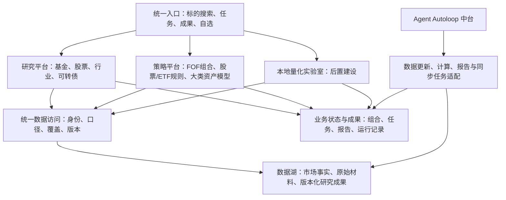

**综合投研平台整合可行性报告与大体改造方向**

> 历史调研，保留 2026-11-06 原始判断。2026-11-15 已调整为 YunAlpha 架构；当前模块边界和顺序以 [整体架构](ARCHITECTURE.md)、[路线](ROADMAP.md) 和 [第一阶段分工](PHASE1_PLAN.md) 为准。本文的完整基金看板和按资产类别建设平台不再作为当前开发要求。

调研日期：2026-11-06。范围：此前列出的14个项目项，以及与基金看板、产业链和股票研究直接相关的辅助项目。方法：读取架构与验收资料，抽查入口、数据读取、计算、任务和发布代码，检查现有产物，并通过 SSH 只读检查云端目录、配置报告源码和机器资源。本轮未修改项目代码、调度、数据湖或云服务，也未重新运行各项目的完整测试。历史验收表示已有证据，不等同于本轮重新验收。

**一、结论：可行，且现有成果足够支撑分阶段整合**

建议形成“研究平台 + 策略平台 + 本地量化实验室”，由统一数据湖供给数据、Agent Autoloop 统筹任务。主动基金作为第一阶段的产品核心。

真正需要统一的是标的身份、数据口径、研究与策略对象、导航、任务状态和成果管理。源码合并与部署合并应跟随这些业务边界推进。先把所有仓库搬进一个目录、先换一套网页外观，都不足以完成整合。

总体判断如下：

| 方向 | 可行性判断 | 主要工作与条件 |
|---|---|---|
| 主动基金研究整合 | 高，最适合先做 | 以同一基金/经理为中心，打通看板、研究 Agent、深度报告、配置报告与组合入口 |
| 基金共用看板 | 高 | 统一基础指标和比较能力，按主动权益、主动量化、指增等类型展示专属分析 |
| 三套策略工具合并 | 高，但语义设计比页面拼接重要 | 保留组合管理、模型配置、规则回测三类工作流程，统一策略与运行管理，逐步统一可兼容的计算 |
| 统一数据湖 | 基础已具备，迁移量较大 | 旧 CSV/Excel、知识材料、私募数据和模型信号仍需归入受控的数据供给；不能只切换一个路径 |
| 中台统一管理 | 可行，适合扩展接入 | 已有定时、事件、命令任务、重试与通知机制；仍需对接各业务任务和数据就绪状态 |
| 指增自动深度研究 | 有明确起点，尚非完整产品 | 已有八章设计及真实 Part1 样章，后七章的数据、计算与研究方法仍需设计 |
| 股票与行业研究 | 有能力储备，产品定位未定 | 先围绕研究问题组织能力，利用产业链 Agent、基金持仓穿透和图表验证，避免堆积原站全部页面 |
| 量化实验 | 保留接口，实施最后 | 当前实验框架不阻塞研究平台、策略平台和中台建设；以后由研究验证决定哪些策略进入持续跟踪 |

最先值得交付的闭环是：**打开基金看板 → 选择基金 → 查看数据和历史研究 → 对话追问或生成报告 → 查看配置角色 → 加入 FOF 组合 → 回测 → 持续跟踪。** 这一条路径能够直接连接已有成熟成果，并检验平台整合是否真正有价值。

**二、实际项目盘点及建议归属**

以下成熟度根据代码、运行产物和已有验收判断，不能理解为所有数据、所有场景均已验证。

| 项目项 | 已有内容与当前边界 | 在大平台中的归属 |
|---|---|---|
| 1. 普林格周期展示 | 模型介绍、模型形成过程和研究材料；当前入口已移除旧实盘跟踪模块，部分旧说明仍保留历史描述 | 策略平台的“大类资产模型”研究与说明 |
| 2. 行业轮动 | React 看板、行业指标、季度景气评分、趋势和行业报告 | 行业研究展示归研究平台；由评分生成的轮动规则及回测归策略平台，共用同一版评分 |
| 3. 宏观组合回测 | 多类资产、普林格阶段权重、风险调整、单类资产研究、策略保存及归因 | 策略平台的大类资产配置工作台 |
| 4. 基金深度分析报告 | 投资手册、十部分报告、审核、交互 HTML、Word 和报告问答；已上云 | 基金研究的深度报告产品与历史成果库 |
| 5. 单基金配置报告 | 云端保留52个基金报告目录及八部分生成代码，覆盖配置定位、行为、能力、盈亏、交易和因子画像 | 基金研究的配置分析产品；连接 FOF 组合管理 |
| 6. 基金组合管理平台 | 手动选基金与分组、权重和调仓计划、资金与费用、日/周/月分析、组合保存、结果快照、持仓与风格穿透 | 策略平台中的 FOF 组合工作台，保留完整组合管理能力 |
| 7. 基金研究 Agent | 对话、受控工具、证据、知识检索、后台报告任务、检查点恢复；已具备上云准备设计 | 第一阶段作为基金研究专属 Agent，复用其报告任务与工具边界 |
| 8. 可转债看板 | 个券、市场、专题、行业、异动、回售等；只读湖数据，有快照刷新机制 | 研究平台的可转债入口，先完整接入，维持较低扩展优先级 |
| 9. 可转债回测 | 手工组合、持仓计划、规则排序、双低、任务、结果、策略库及报告；部分策略为原站参考记录 | 扩展为策略平台的重要组成；可转债计算与股票规则分别声明适用范围 |
| 10. VIC 逆向 | 前端、接口契约、研究流程证据与离线回放；不具备原站完整后端和持续生产能力 | 作为研究平台的能力与交互参考，按需求独立实现，不直接算作成熟在线研究服务 |
| 11. 量化策略研究平台 | 名称尚未唯一确认；本轮检查了日线量化研究台，并把 Self-quant、SilverM 作为其他候选/参考 | 暂列本地量化实验室；不在本轮决定最终选哪一个作为实现基线 |
| 12. 数据湖 | Parquet、查询 SDK、PIT、采集编排、质量检查、发布回执和日更；部分应用已接入 | 所有平台的数据权威来源与受控发布者 |
| 13. Agent Autoloop | 定时/事件、规则派发、命令及 Agent 接入、持久任务事实、通知和人工反馈；没有内置管理网页 | 统一运行与调度中台；管理页面作为其外部客户端 |
| 14. 一技之长逆向 | 日线业务契约、算法与交互证据、离线浏览；研究台已有独立实现 | 股票研究/量化实验的参考资料与验收依据，不作为生产数据源 |

还应纳入整合评估的现有资源：

| 资源 | 本轮发现 | 建议使用方式 |
|---|---|---|
| 量选基金平台 | 已有市场、产品、公司、私募、业绩、行业偏离、持仓、Barra 等展示；实际静态目录已远超 README 的早期8/9只试验范围。目录读取到424条总览记录和717份产品 JSON，计数口径不同，不应当作同一基金池 | 作为统一基金看板的主要参考与迁移来源，不必从零重做全部分析展示 |
| 指增研究样章 | 位于基金 Agent 内，八章研究框架已写出，000311.OF 的 Part1 有真实完成回执和验收产物；未接入完整聊天/Worker/知识库 | 后续指增深度研究的起点；仍需逐章讨论，不把样章视为完整自动报告 |
| 产业链研究 Agent | 已有来源整理、产业结构、冻结财务快照、分环节研究、审核、报告、图谱及四张研究表入湖；存在真实 MLCC、光模块、储能案例 | 行业/产业链研究优先复用的独立能力，可支撑股票研究方向 |
| 资产池数据看板、私募数据看板 | Excel 及脚本驱动的筛选评价、收益和风险统计，含私募原始资料 | 提取指标、分类与数据来源，接入统一基金/资产池看板 |
| CNE5 | 因子计算、因子收益及基金风格分析相关资料 | 作为因子与风格计算来源；不能因已有旧快照就宣称已能每日更新全部画像 |
| ETF及资金流动 | 独立取数、静态构建与展示 | 作为 ETF/市场研究补充，取数逐步归入湖侧 |
| BI及基金JSON脚本 | 旧报表和报告素材加工链路 | 保留必要的数据加工与历史口径，逐步纳入可复查的共享数据产品 |

两个需要先保全的事实：单基金配置报告的旧本地目录已找不到，但云端仍有运行代码和产物；基金报告实现同时出现在独立项目、数据湖仓库子项目和 Agent 的历史实现副本里。正式改造前需确定各部分的维护基线，不能仅按目录名或修改时间选一个覆盖其他版本。

**三、目标形态：一个平台入口，三类工作空间，两个公共底座**

图表示建议的目标职责，不表示这些连接已经全部落地。中台管理任务，应用仍通过数据服务读取已发布的数据；中台短时不可用不应影响现有报告和历史结果的阅读。

建议一级导航控制在“研究、策略、量化实验、运行管理”几项。研究内部按基金、股票、行业、可转债进入；策略内部按组合工作台、策略库、回测运行和跟踪进入。数据湖完整治理与中台日志放在运行管理中，普通研究页面只显示与当前研究有关的数据日期、缺口和任务进度。

统一展示应围绕对象组织：同一只基金有一个身份入口，可展开业绩、持仓、风格、经理、深度报告、配置分析和 Agent；同一策略有一个入口，可查看版本、回测、报告、信号和跟踪。页面之间携带标的、时间范围和版本，减少反复搜索与重新填写。

统一视觉优先覆盖导航、搜索、筛选、表格、图表、日期/单位、状态提示和报告阅读。已有内容先保持可用，随后逐步把成熟页面纳入统一组件；最终需要消除重复的基金选择器、策略目录和任务入口，不能长期停留在六个网址的链接集合。

**四、基金研究：最适合作为整个平台的第一阶段**

主动基金可以组织成三个相互关联的层次：

1. **持续观察的基金看板**：净值、收益、风险、规模、经理、披露持仓与风格，支持筛选和比较。
2. **有版本的研究成果**：深度报告回答“经理怎么投资、收益从哪来”；配置报告回答“承担什么组合角色、与什么互补、如何跟踪”。两者共用身份和证据，保留各自研究目的。
3. **可操作的研究入口**：基金 Agent 查数据、解释变化、检索历史报告、创建新报告；研究结论可把基金送入 FOF 候选池。

建议主动基金与量选/指增使用同一个基金看板入口，并共享基础指标与比较组件，但保留分类分析。主动权益着重经理任期、能力圈、持仓和风格演变；指增着重合同基准、超额稳定性、跟踪误差、信息比率、主动偏离与规模费用；主动量化按其实际基准和策略特征评价。公募/私募也是数据和披露条件的差异，不宜把所有产品压成一个综合分数。

看板的“日频更新”应指每日检查并刷新已发布的新数据：净值和业绩按可获得的净值日更新，持仓、规模、换手和报告按真实披露更新，私募按实际提供频率更新。基于低频持仓估算的最新暴露必须明确写为估算，不能显示成当日真实持仓。

深度报告保持输入和结论的历史版本，最新数据另在看板或更新说明中展示。新季度报告、经理变更或重大持仓变化可触发增量研究；无需每天重新生成全部长报告。这样既保留已有研究价值，也避免新行情悄悄改变旧报告结论。

**基金 Agent 的建议路线是先专后广。** 第一阶段放入基金研究平台，完善其对统一看板、深度报告、配置分析和 FOF 候选池的连接。以后股票与行业工作流成熟，再提供一个研究平台级对话入口，把问题交给基金、公司、产业链等专业能力。通用的身份、证据、任务和成果可以共享，专业提示词、计算及审核标准继续独立。

自行构建策略应更后置：先具备明确的策略描述、参数校验、执行规则和可复现回测，再让 Agent 调用这些能力形成草案。仅把基金 Agent 改名为“全能研究 Agent”，不能补上跨资产研究方法和策略计算。

指增方向已有样章值得继续，但最难的部分在 Part2–8：基准及全收益口径、完整披露与同日指数权重、历史因子覆盖、超额统计和同类可比池。深度报告不能靠增加叙述长度获得深度，也不能从公开低频持仓推断管理人的内部模型。现有研究框架已经记录这些边界，可沿其逐章设计。

**五、股票、行业和可转债：围绕研究问题安排能力**

股票研究建议在基金整合之后重点讨论。当前较有价值的三个切入点是：

| 研究入口 | 核心问题 | 现有可复用资源 |
|---|---|---|
| 从基金持仓看公司 | 哪些经理在持有/增减？公司的经营变化是否支持他们的投资逻辑？ | 基金研究、经理观点、披露持仓、湖内行情与财务 |
| 从产业链看公司 | 公司处在哪个环节，收入利润怎样受行业变化影响，证据与反证是什么？ | 产业链 Agent、行业景气看板、VIC 研究参考 |
| 从研究假设持续跟踪 | 原判断的关键指标是否兑现，什么变化需要重新研究？ | 版本化研究结论、财务/公告、日线图表、一技之长规则与信号参考 |

公司数据总览和图表可以作为这些研究的基础工具。把财务、估值、股东、行情等全部铺满首页，并不能自动形成研究方法。建议先确定一条完整研究路径，形成“问题—证据—判断—跟踪指标—新信息复核”的闭环，再扩充页面。

行业研究应包含景气比较与产业链分析。已有行业评分可进入研究平台，也能成为行业轮动策略的输入；评分方法和版本应只维护一份，研究展示与策略计算分别消费。普林格属于大类资产模型，主入口放在策略平台，其宏观输入可被研究页面引用。

VIC 和一技之长的逆向成果按能力参考与证据档案保留；已独立实现且接入数据湖的能力才进入正式运行。离线录制响应、未恢复的原站计算和自有生产结果应继续区分。

可转债先完成研究入口、共同标的选择、日期状态与策略跳转整合。现有看板已经有足够多的页面和分析，当前不需要增加模型或继续扩大研究深度。

**六、策略平台：保留三类工作流程，统一共同对象**

建议把策略平台组织成“组合工作台 + 策略库 + 回测与结果 + 持续跟踪”。在组合工作台中保留手动 FOF 配置，在策略库中管理可执行规则和大类资产模型，二者可以互相引用，但不强行变成同一种表单。

| 现有工具 | 必须保留的产品能力 | 可以共用的部分 |
|---|---|---|
| FOF 组合管理 | 自选基金、三类分组、权重、资金/费用、手工调仓、组合版本和分析窗口 | 标的池、组合身份、持仓计划、结果目录、风险与穿透分析 |
| 普林格组合回测 | 阶段信号、资产类别选择、权重档位、风险调整、模型与阶段归因 | 策略版本、信号记录、目标组合、回测任务、基准及跟踪 |
| 可转债/股票规则回测 | 候选池、筛选排序、持仓导入、任务恢复、执行账本、策略保存与报告 | 策略目录、参数、目标持仓、运行记录、绩效展示、导出 |

平台应区分四个对象：**组合**是用户管理的配置方案；**策略版本**是可复用的决策规则及参数；**运行**是在确定数据和时间区间上的一次计算；**跟踪**是针对已选定组合/策略版本持续计算新信息。手工配置本身也是完整的一种组合来源，不必伪装成自动选基策略。

共同计算链路可概括为“数据与候选池 → 规则/人工配置/模型 → 目标持仓 → 适用的执行计算 → 净值、持仓、交易、归因与报告”。将来新增策略，接入候选池、规则或模型即可复用已有结果和管理能力。

统一时要保留市场差异。基金净值与申赎、股票交易日与手数、可转债报价与终止事件、大类资产收益序列的含义不同。先为三套现有计算提供一致的输入输出说明和版本身份；经过等价核验后，再合并能够共享的计算。不同成交时点、费用、价格/全收益和估值规则的结果，应明确口径后比较，不能只因都输出“年化收益”就直接排名。

两个实际限制会影响“日频策略更新”：可转债平台已有25条原站参考策略，不能全部算作本地可执行策略；红利低波目前接入的是既有 `cfo_timing80` 冻结目标，可以执行和重放，并不自动具备持续生成未来目标的能力。策略目录应说明可执行、仅历史目标可重放、参考资料、缺数据/模型等状态。

这里的 FOF 是用户管理的基金组合；湖内公募 FOF 产品的底层持仓属于另一类资产数据。两者可以关联，但不能用公募 FOF 数据覆盖度替代自建组合工作台的完成度。

**七、统一数据湖：统一权威来源，同时保留必要的业务状态**

目标可以实现，但“所有应用可读写、不能删改”需落实为明确的发布方式：**应用读已发布数据，新增资料与研究结果提交到候选区；只有受控发布流程能形成正式版本。** 应用不能直接覆盖正式行情、财务、净值或他人的研究成果。

建议区分以下三类数据：

| 类别 | 例子 | 处理方式 |
|---|---|---|
| 共享事实和来源材料 | 行情、净值、持仓、财报、研报、公告、路演、私募提供的原件 | 统一归档、身份和日期，记录来源与质量，经数据湖发布后消费 |
| 可共享的研究/计算成果 | 因子版本、行业评分、研究报告、图谱、策略信号 | 与原始事实区分，记录模型/方法/输入版本，按授权数据集追加新版本 |
| 应用运行与用户状态 | 会话、任务、组合草稿、偏好、运行日志、缓存 | 各应用按业务管理；关键组合和策略变化留修订，不必将所有状态变成行情湖表 |

数据湖是统一权威来源，并不要求每个网页请求都扫描原始 Parquet，也不要求所有状态只有一个物理数据库。只读查询缓存、图表数据包和云端只读副本可以存在，但必须带来源版本、可重建、不能自行产生另一套事实。

目前湖侧已经有原件归档、Schema/主键校验、共享写锁、发布前备份和回执。产业链 Agent 还实现了限定四张研究表、版本提交后可见的接入方式，可以作为受控成果发布的参考。

但现有湖**并不是所有正式文件永久不变的存储**：正常 compact 会合并并替换当前分区，部分维护流程也支持经核验的分区替换。应将业务层“禁止任意覆盖历史”与底层文件整理区分开来。行情纠错、供应商修订和补空必须保留来源、旧版本或可恢复依据，并形成新的可查询版本；不能因“不能改”而永久保留错误，也不能用新增同键行制造不明确的当前值。

需要优先补齐的共同约定是：标的/份额/经理身份、指标单位和基准、交易日/报告期/公告可见日/采集日、数据版本、公式版本和缺失语义。历史回测既要知道“当时公告了什么”，也要知道“这次运行究竟用了哪版数据”；这两个问题不能只用一个截止日期解决。

部分旧应用仍直接读 CSV/Excel，基金 Agent 也还有旧 DuckDB 视图、正式手册和知识库依赖。迁移时应将必要来源入湖或纳入统一材料归档，再提供兼容读取，保存旧结果用于对照。股票、宏观模型和因子库也需逐项核定输入，不能因数据湖里有同名指标就认定数值定义一致。

数据质量宜按任务依赖放行。本轮读取的湖状态文件中，股票、指数及转债有到11月6日的水位，基金净值有到11月5日的水位；这些不证明所有标的完整。留存健康快照仍列出复权和重复键问题，并含滞后/空数据集；需结合快照生成时点及具体任务复核。另一方面，最新历史股票池专项证据已将目录内退市覆盖检查记为通过，不能继续照抄旧 README 的缺口结论。用“全湖正常/异常”一个灯决定所有功能是否可用，会同时造成误放行和不必要的阻塞。

**八、大中台：统一外层调度，保留业务内部流程**

Agent Autoloop 的实际能力与需求基本匹配：可定时、接收事件、去重、分组限制并发、派给命令或 Agent、记录回执，并通过通道通知。它有通用 command 插件，因此数据采集、指标计算和静态构建可以直接调用确定性程序，日常运行不必每次消耗模型。

它仍是通用任务中台，没有现成的证券主数据、数据质量管理、报告仓库、策略库和管理网页。本轮检查到的是本地源码包；默认 `~/.agent-autoloop` 安装目录不存在，尚不能证明它已按其他路径部署，更不能将其写成已接管投研业务。

职责建议如下：

| 中台负责 | 业务模块继续负责 |
|---|---|
| 何时触发、在哪运行、并发组、跨项目进度、通知、故障汇总 | 数据湖内部批次、限频、采集、质量与发布 |
| 向报告服务提交任务并跟踪它的业务ID | 报告章节、模型调用、审核、检查点与恢复 |
| 启动策略跟踪任务、记录执行版本和结果指针 | 选券/选股规则、组合计算、撮合、风险和指标 |
| 同步已完成成果到展示端，报告成功/失败 | 应用自己的会话、组合、用户操作和数据存储 |

一条合适的日常链路是：

**按数据源披露节奏触发 → 湖内增量采集与核验 → 发布数据版本 → 检查各应用所需数据是否就绪 → 刷新相关指标/看板 → 执行已登记的策略跟踪 → 同步成果 → 在重要变化或异常时通知。**

不同数据域不必等全湖完成才更新。A股收盘、基金净值、海外资产、公告材料各有不同时间；定时是触发条件，发布完成与覆盖合格才是下游可以运行的条件。

报告按用户请求或重要新披露触发，不纳入每日全量重生成；量化提醒仅针对未来明确登记的成熟策略及其有效数据窗口，不把实验回测结果直接变成日常信号。

需要避免三类重复：中台重复创建已存在的报告任务；中台和数据湖两层同时整批重试；旧系统定时与新中台同时启动同一采集。现有机器有新旧两份湖调度文件，其中一份旧启动路径已不存在，不能据此说两个都在正常跑，但接管前必须清点归属。中台错过定时只补最近一次，数据完整性需由湖的水位与缺口补偿实现。

中台默认没有界面并不妨碍建设运行管理页。可以用它现有状态/事件接口，加上湖和业务任务的摘要，呈现任务、数据新鲜度、失败原因、运行位置和成果。业务运行状态依然以业务服务为准：进程退出0、成功提交Job、报告真正完成是三个不同状态。

**九、本机与云端安排**

先本机实现很合理。它减少了数据复制和远程任务接续的复杂度，适合先检验基金研究闭环与三类策略工具的整合。

截至本轮检查，数据湖目录占用约34GB；当前六模块云机总内存约1.6GB，磁盘约40GB、可用约28GB。这个环境适合继续承载当前轻量展示和部分计算，不适合直接追加完整湖、全部 Worker 和并发报告任务。仅复制现有湖目录就已超过当前可用磁盘，后续还有运行产物、缓存、备份和增长。

建议把上云拆成三种可独立选择的能力：

1. **成果展示上云**：先发布报告、看板数据包、策略历史结果与目录，云端保留版本信息。
2. **交互计算上云**：需要远程临时回测/对话时，再提供受控查询数据与计算资源；不能只上传静态报告却称为完整交互平台。
3. **持续生产运行**：若要求电脑合盖后仍能每日更新和生成报告，才将相应数据与 Worker 迁往常开机器。可以由同一中台管理本机和远端执行端。

本机作为数据权威、云端作为只读展示时，复制的是带版本的发布产物；若以后迁移数据权威位置，应明确切换唯一写入者，避免本机与云端各自独立修改正式数据。

现有管理员/访客访问入口和只读访客行为也是已有产品能力，上云整合时应延续。无需为本轮可行性设计提前建立复杂组织权限体系，但也不能让统一页面使访客获得组合保存或后台管理能力。

**十、分阶段改造顺序与完成标准**

| 阶段 | 大体范围 | 这一阶段应交付的可检查结果 |
|---|---|---|
| 0. 保全与统一基础 | 确认代码/数据权威、保全云端配置报告、建立标的与版本约定，确定旧入口和用户资料迁移基线；中台先接一个现成任务 | 能指出每项功能来源，旧报告/组合/策略不丢；一条真实更新任务有可追踪结果 |
| 1. 主动基金研究闭环 | 基金看板基础、基金 Agent、深度报告、配置报告、历史成果和 FOF 候选池相连 | 同一基金贯穿查看—追问—报告—配置—加入组合；身份、日期和引用一致，HTML/Word与历史版本可用 |
| 2. 策略平台整合 | 三类工作台、统一策略/组合/运行目录、共同结果展示，保留原有计算与特有功能 | 原三套代表性业务都能完成；同输入同计算版本的收益、持仓和费用与基线一致，新策略有明确接入位置 |
| 3. 指增与量选研究 | 优化基金看板专属分析，从既有样章推进自动研究流程 | 指标由可复查计算支持，报告有适用基准、数据覆盖及引用；逐章形成完整工作流 |
| 4. 股票与行业研究 | 选择核心研究路径，接产业链 Agent、基金持仓穿透、公司与行业分析、跟踪 | 一个明确问题能形成有证据的结论，并在新信息到来时复核，不以页面数量验收 |
| 5. 本地量化实验 | 再决定日线研究台、Self-quant等的取舍与接口，接入湖及中台 | 实验、稳定策略和持续提醒状态清楚，关键结果可复现；仅经过验证的策略进入正式跟踪 |

可转债展示适配可以在阶段1–2中完成，不单独扩建。中台与数据契约贯穿各阶段逐步完善，不应等建完一个庞大的“万能中台”才开始交付基金产品。上云是成熟模块的发布阶段，不必等量化实验实现后再进行。

以上是先后关系，不是工期承诺。当前未确定的股票产品定位、指增报告深度，以及配置报告缺失的本地生成输入，会显著影响工作量；在这些范围确认前，给出统一周数缺少依据。

**十一、主要整合风险及应对方向**

| 已观察到的情况 | 对整合的影响 | 大体应对 |
|---|---|---|
| 多个目录保存报告引擎、副本与旧材料；配置报告本地目录缺失 | 选错维护基线、丢失生成能力，或多处重复修同一问题 | 先明确权威版本与素材清单，恢复可复现基线，再逐步去除重复维护 |
| 同一基金指标散布在静态看板、Excel、报告和回测中 | 同页面同名指标出现不同日期、分母或收益口径 | 共同指标定义与有版本计算，保留真正不同的研究口径 |
| 当前 Parquet 发布会合并/替换文件，部分应用靠本地路径与视图读取 | “只追加”停留在约定，历史任务可能读取更新后的数据 | 受控发布、版本标识和固定任务输入；逐步收拢直接读取入口 |
| 原站参考策略与本地策略并存，部分股票策略只有冻结目标 | 策略库看似丰富，却不能持续生成新信号 | 展示真实能力状态，分别管理参考、可重放和可持续执行 |
| 数据日更、报告Worker和中台都有任务与恢复逻辑 | 多层重试、重复任务、重复通知或重复采集 | 中台管跨项目触发，业务管内部执行；共同使用业务ID和幂等键 |
| 前端包含静态页、React、Vue，运行环境也不同 | 一次性统一技术栈会扩大改造面并拖慢基金交付 | 先统一使用体验与接口，逐页迁移；运行环境保持明确边界 |
| 单人维护多个产品与大体量数据 | 复杂微服务和过多基础组件增加维护负担 | 优先模块化应用和少量独立Worker；只在隔离或负载确有需要时拆部署 |

对应的架构判断是：需要收拢的是同一业务知识的重复维护和跨项目隐式依赖；不同资产的计算差异、各报告的研究目的、数据湖与任务中台的职责，应作为稳定边界保留。这与 Brooks 的概念一致性、DDD 的边界及旧系统渐进替换原则相符。本报告按用户要求给出整合可行性，未将跨项目抽查包装成完整代码质量评分。

“不阉割内容”的验收应落在行为上：保留旧组合、调仓计划、费用、策略定义、报告下载、结果快照、用户记录；代表性历史输入由相应版本重放，差异可解释。旧页面可作为过渡入口，确认新路径覆盖后再退役。一个按钮还在、一个页面能打开，不足以证明功能迁移完成。

**十二、建议先采用的方向，以及留待后续逐项讨论的事项**

建议现在采用：主动基金优先；共用基金看板、分类研究；基金 Agent 先专用；FOF保留工作台身份；三套策略计算先通过统一管理连接；数据湖受控追加与版本化发布；Autoloop做外层调度；本地先行；量化实验最后。

后续讨论顺序建议从“基金页面与研究闭环”开始，接着讨论“深度报告和配置报告如何共用证据并各自保留价值”，再确定策略平台里的组合、策略与运行关系。指增八章研究方法、股票研究主线、全平台 Agent、云端计算范围可以随后分别定稿。本轮不需要先决定所有远期功能，已有基金产品的整合不会因此受阻。

**附：项目位置与证据索引**

| 项目/资源 | 本地或已确认位置 |
|---|---|
| 统一云端入口源码 | [research-platform](/path/to/local-user/项目/肖皓匀/普林格周期（三合一）/research-platform)；云端 `/data/www/Research_Platform` |
| 普林格展示 | [普林格周期（三合一）](/path/to/local-user/项目/肖皓匀/普林格周期（三合一）)；云端 `/data/www/Macro_Research_Platform/portal` |
| 行业轮动 | [行业轮动看板数据重构](/path/to/local-user/项目/肖皓匀/行业轮动看板数据重构)；云端 `/data/www/Macro_Research_Platform/industry` |
| 宏观组合回测 | [股债商底层自定义标的](/path/to/local-user/项目/肖皓匀/普林格周期回测平台/股债商底层自定义标的)；云端 `/data/www/Macro_Research_Platform/backtest` |
| 深度报告 | [投资手册+深度报告Agent](/path/to/local-user/项目/投资手册+深度报告Agent)；云端 `/data/www/Mutual_Fund` |
| 单基金配置报告 | 云端 `deployment-host:/data/www/Allocation_Report`；本地原 `/path/to/local-user/项目/组合配置1.0` 未找到 |
| FOF组合工作台 | [快速回测引擎](/path/to/local-user/项目/快速回测引擎)；云端 `/data/www/Fund_Backtest_Desk` |
| 基金研究Agent | [基金研究Agent实验平台](/path/to/local-user/项目/基金研究Agent实验平台) |
| 可转债看板与回测 | [可转债投研平台](/path/to/local-user/项目/可转债投研平台) |
| VIC参考 | [VicAlpha网页分析](</path/to/local-user/Documents/ChatGPT/agent 学习/VicAlpha网页分析>) |
| 日线量化研究 | [日线量化研究台](/path/to/local-user/项目/日线量化研究台) |
| 其他量化候选 | [self-quant-master](/path/to/local-user/项目/self-quant-master)、[SilverM-quant-main](/path/to/local-user/项目/SilverM-quant-main) |
| 一技之长参考 | [ZGNB网站逆向](</path/to/local-user/Documents/ChatGPT/agent 学习/ZGNB网站逆向>) |
| 数据湖 | [多资产智能投研平台-v2](/path/to/local-user/项目/多资产智能投研平台-v2)，正式数据 `lake/` |
| 中台 | [agent-autoloop-main](/path/to/local-user/项目/agent-autoloop-main) |
| 量选基金看板 | [量选基金平台](/path/to/local-user/项目/量选基金平台) |
| 产业链Agent | [产业链研究Agent](/path/to/local-user/项目/产业链研究Agent) |
| 辅助数据与分析 | [资产池数据看板](/path/to/local-user/项目/资产池数据看板)、[私募数据看板](/path/to/local-user/项目/私募数据看板)、[CNE5](/path/to/local-user/项目/CNE5)、[ETF及资金流动](/path/to/local-user/项目/02ETF及资金流动)、[BI及JSON](/path/to/local-user/项目/01BI平台及JSON数据) |

主要可复查依据：

- 基金研究的三层边界：[架构说明](/path/to/local-user/项目/基金研究Agent实验平台/docs/architecture.md)、[报告工作流](/path/to/local-user/项目/基金研究Agent实验平台/docs/report-workflow.md)、[工具注册](/path/to/local-user/项目/基金研究Agent实验平台/src/fund_research_agent/tools/builtin.py:260)。
- 指增工作已完成与未完成范围：[八章框架与Part1样章](/path/to/local-user/项目/基金研究Agent实验平台/docs/index-enhancement-research.md)、[实际完成回执](/path/to/local-user/项目/基金研究Agent实验平台/var/index_enhancement/000311-20261026-part1/result_manifest.json)。
- 旧深度报告能力：[项目架构](/path/to/local-user/项目/投资手册+深度报告Agent/docs/architecture.md)。单基金配置报告八部分内容以本轮云端 `agent/prompts.py`、`agent/loader.py`、`agent/data_pack.py` 与 `serve.py` 抽查为依据。
- FOF组合与计算：[组合存储](/path/to/local-user/项目/快速回测引擎/backtest_platform/portfolio_store.py)、[基金回测](/path/to/local-user/项目/快速回测引擎/backtest_platform/fund_backtest.py)、[穿透分析](/path/to/local-user/项目/快速回测引擎/backtest_platform/exposure_analysis.py)。
- 宏观模型与回测：[服务及计算入口](/path/to/local-user/项目/肖皓匀/普林格周期回测平台/股债商底层自定义标的/backtest_platform/server.py)。
- 可转债数据、策略及历史目标边界：[契约](/path/to/local-user/项目/可转债投研平台/CONTRACT.md)、[进度记录](/path/to/local-user/项目/可转债投研平台/PROGRESS.md)、[策略目录](/path/to/local-user/项目/可转债投研平台/cb_platform/catalogue.py)。
- 产业链能力：[架构边界](/path/to/local-user/项目/产业链研究Agent/docs/architecture.md)、[已有验收索引](/path/to/local-user/项目/产业链研究Agent/var/validation/final-checks.json)。
- 日线研究台范围：[平台扩展验收](/path/to/local-user/项目/日线量化研究台/docs/平台扩展验收.md)。
- 量选看板实际产物：[目录](/path/to/local-user/项目/量选基金平台/site/data/catalog.json)、[质量记录](/path/to/local-user/项目/量选基金平台/site/data/data_quality.json)。
- 数据湖发布和物理合并：[发布流程](/path/to/local-user/项目/多资产智能投研平台-v2/src/multi_asset_lake/storage/publication.py)、[Parquet合并](/path/to/local-user/项目/多资产智能投研平台-v2/src/multi_asset_lake/storage/parquet.py:202)。
- 数据湖日更及最新修复：[运维手册](/path/to/local-user/项目/多资产智能投研平台-v2/docs/operations/runbook.md)、[11月5日净值专项记录](/path/to/local-user/项目/多资产智能投研平台-v2/docs/operations/nav-entity-repair-20261105.md)、[健康快照](/path/to/local-user/项目/多资产智能投研平台-v2/lake/meta/quality/health-latest.json)、[历史股票池专项快照](/path/to/local-user/项目/多资产智能投研平台-v2/lake/meta/quality/historical-validity-latest.json)。这些状态文件可能随后更新，本文仅描述本轮读取结果。
- 中台能力与边界：[维护原则](/path/to/local-user/项目/agent-autoloop-main/AGENTS.md)、[协议](/path/to/local-user/项目/agent-autoloop-main/docs/protocol.md)、[命令任务插件](/path/to/local-user/项目/agent-autoloop-main/plugins/command/agent.ts)。
- 云端六模块及访问行为：[部署维护记录](/path/to/local-user/.codex/skills/deploy-fund-backtest-desk/SKILL.md)，并已通过 SSH 核对目录、路由、运行服务与机器资源。
